# artagram-payment

Microservicio responsable de **pagos y suscripciones**: checkout, webhook
del proveedor de pago, cuotas de plan (megabytes/obras). Extraído de
`artagram-users/src/main/java/com/artagram/users/{billing,service/SuscripcionService.java,...}`
— facturación tiene un perfil de seguridad y ciclo de vida distinto al de
perfil de usuario (secretos de webhook, proveedor externo), así que no
pertenece junto a `artagram-users`.

## Puerto y base de datos

- Puerto local: `8089`.
- Base de datos propia: `db_payment` (Postgres) — **no** tiene FK a
  `usuarios`: esa tabla vive en la base de datos de `artagram-users`. El
  estado premium se sincroniza localmente vía el evento `user.registered`
  (ver `PaymentUserEventListener`), no con una consulta en vivo.
- RabbitMQ: consume `user.registered`/`user.deleted` para sembrar/limpiar
  su propio estado; publica `subscription.updated` al aprobar un pago, con
  el **mismo payload** que antes publicaba `artagram-users`, para que
  `artagram-canvas` y cualquier otro consumidor existente sigan
  funcionando sin cambios.

## Qué se portó de `artagram-users` y qué cambió

- `common.*`/`auth.*` — copiados tal cual de `artagram-canvas` (mismas
  convenciones de trazabilidad, manejo de errores, CORS y validación JWT
  RS256 manual, sin Spring Security).
- `SuscripcionService`/`Suscripcion`/`UsoCuenta`/sus repositorios — portados
  de `artagram-users`, sin dependencia de `UsuarioRepository`: el campo
  `premium` ya no vive en una entidad `Usuario` ajena, se deriva de
  `plan == "PRO" && estado == "ACTIVA"` en la propia `Suscripcion`.
- `SuscripcionController` (`/api/suscripcion`: `GET /actual`,
  `POST /checkout`, `POST /confirmar?tx=...`) — mismas rutas que antes, para
  no romper el frontend.
- **Fix de diseño deliberado**: en el código original, `MercadoPagoProvider`
  decidía Fake-vs-real internamente mirando si el access token estaba en
  blanco (con `@Primary` + un fallback a `FakePagoProvider` dentro del
  propio bean) — el env var `PAGO_PROVEEDOR` existía en `application.yml`
  pero nunca se leía en código. Aquí la selección la hace Spring vía
  `@ConditionalOnProperty(prefix="app.pago", name="proveedor", ...)`, el
  mismo patrón que usan `StorageProvider`/`EmailService` en el resto del
  workspace: la existencia del bean ES la selección. Sigue siendo un stub
  (sin llamadas reales al SDK de MercadoPago).
- **Nuevo** (no existía nada parecido antes): `PagoWebhookController`
  (`POST /api/pagos/webhook/mercadopago`) y `MercadoPagoWebhookVerifier`
  (HMAC-SHA256 contra `MERCADOPAGO_WEBHOOK_SECRET`, verificación
  simplificada — el formato real de MercadoPago usa un manifiesto
  distinto). El único flujo de confirmación que existía antes era el
  `confirmar` manual/autenticado por JWT, que se mantiene para el proveedor
  Fake y para pruebas manuales.
- `InternalPaymentController` (`GET /internal/payment/{usuarioId}/plan`) —
  renombrado de `/internal/users/{id}/plan`.

## Variables de entorno

Ver `.env.example`. Las relevantes de pagos: `PAGO_PROVEEDOR` (`fake` por
defecto, o `mercadopago`), `MP_ACCESS_TOKEN`, `MERCADOPAGO_WEBHOOK_SECRET`.

## Cómo correrlo en local

```bash
docker compose -f ../artagram-infra/compose.yml -f ../artagram-infra/compose.services.yml \
  up -d --build artagram-payment
curl -s http://localhost:8089/actuator/health
```

Requiere que `db_payment` exista en el Postgres compartido — ver el paso
manual documentado en el plan de implementación (el init-script de
`artagram-infra` solo crea bases nuevas en un volumen Postgres recién
creado).

## Fuera de alcance de esta migración

`artagram-users` sigue teniendo el código viejo de `billing`/
`SuscripcionService` — queda como código muerto hasta el corte del gateway
y la verificación de este servicio; borrarlo es un cambio aparte.

## Descripción del servicio

`artagram-payment` es el microservicio de Artagram encargado de **suscripciones
y pagos**: expone el estado del plan del usuario (`GRATIS`/`PRO`) y sus cuotas
de uso (megabytes y obras), orquesta el checkout contra un proveedor de pago
intercambiable (un proveedor `FAKE` simulado o `MercadoPago`), y recibe el
webhook de confirmación de pago que activa la suscripción `PRO`. Existe como
servicio separado porque fue **extraído de `artagram-users`**: a diferencia del
perfil de usuario, la facturación maneja secretos sensibles (token de acceso
de MercadoPago, secreto de verificación del webhook) y tiene un ciclo de
despliegue y un perfil de seguridad propios, distintos de los del resto de
datos de usuario. Por eso no comparte base de datos con `artagram-users`: no
tiene una relación JPA/FK a una tabla `usuarios`, sino un `usuarioId` plano
(`UUID`) cuyo estado relevante (si existe, si fue borrado) se sincroniza de
forma asíncrona vía eventos de RabbitMQ (`user.registered`/`user.deleted`).

## Responsabilidades

- Exponer la suscripción y el consumo de cuota del usuario autenticado
  (`GET /api/suscripcion/actual`), sembrando una `Suscripcion`/`UsoCuenta`
  por defecto en plan `GRATIS` si todavía no existen localmente.
- Iniciar un checkout de pago (`POST /api/suscripcion/checkout`) delegando en
  el `ProveedorPago` activo (`FakePagoProvider` o `MercadoPagoProvider`), que
  genera la URL de retorno y el id de transacción.
- Confirmar manualmente una suscripción `PRO` vía JWT
  (`POST /api/suscripcion/confirmar`), usado por el proveedor Fake y para
  pruebas manuales.
- Recibir y verificar el webhook de pago de MercadoPago
  (`POST /api/pagos/webhook/mercadopago`), validando la firma HMAC-SHA256
  del cuerpo crudo con `MercadoPagoWebhookVerifier` antes de activar el plan.
- Seleccionar el proveedor de pago (`fake` vs `mercadopago`) en tiempo de
  arranque vía `@ConditionalOnProperty(app.pago.proveedor)`, de forma que la
  existencia del bean en el contexto de Spring ES la selección — sin lógica
  condicional ni fallback dentro del propio proveedor.
- Activar la suscripción `PRO` al aprobar un pago: crea una nueva
  `Suscripcion` con vigencia de 30 días, actualiza las cuotas (`UsoCuenta`) y
  publica el evento `subscription.updated` en RabbitMQ para que otros
  servicios (p. ej. `artagram-canvas`) reflejen el cambio de plan.
- Exponer el plan y las cuotas de un usuario a otros servicios internos
  (`GET /internal/payment/{usuarioId}/plan`), sin autenticación de usuario
  final (endpoint interno/service-to-service).
- Mantener su propio estado de usuario sincronizado por eventos: sembrar
  `Suscripcion`/`UsoCuenta` en `GRATIS` al recibir `user.registered`, y
  eliminarlas al recibir `user.deleted` — sin consultar nunca en vivo la
  base de datos de `artagram-users`.
- Validar JWT RS256 emitidos por `artagram-auth` para identificar al usuario
  en los endpoints públicos (`JwtService`/`JwtUserResolver`), sin Spring
  Security.

## Diagrama de clases

```mermaid
classDiagram
    class SuscripcionController {
        +obtenerActual(request) ResponseEntity~SuscripcionDto~
        +checkout(req, request) ResponseEntity~CheckoutResponse~
        +confirmar(tx, request) ResponseEntity
    }
    class InternalPaymentController {
        +obtenerPlan(usuarioId) ResponseEntity~PlanDetalleDto~
    }
    class PagoWebhookController {
        +mercadopago(payload, firma) ResponseEntity
    }
    class SuscripcionService {
        +obtenerSuscripcion(usuarioId) SuscripcionDto
        +crearCheckout(usuarioId, req) CheckoutResponse
        +procesarPagoAprobado(usuarioId, idTransaccion)
        +obtenerPlanDetalle(usuarioId) PlanDetalleDto
    }
    class ProveedorPago {
        <<interface>>
        +getNombre() String
        +crearPreferencia(usuarioId, plan, retornoUrl) CheckoutResponse
    }
    class FakePagoProvider {
        +getNombre() String
        +crearPreferencia(usuarioId, plan, retornoUrl) CheckoutResponse
    }
    class MercadoPagoProvider {
        +getNombre() String
        +crearPreferencia(usuarioId, plan, retornoUrl) CheckoutResponse
    }
    class MercadoPagoWebhookVerifier {
        +esValida(rawBody, firmaRecibida) boolean
    }
    class PagoProperties {
        -proveedor String
        -mercadopagoAccessToken String
        -mercadopagoWebhookSecret String
    }
    class PaymentEventPublisher {
        +publicarSuscripcionActualizada(usuarioId, premium, plan)
    }
    class PaymentUserEventListener {
        +onUserRegistered(payload)
        +onUserDeleted(payload)
    }
    class JwtUserResolver {
        +resolverOpcional(request) Optional~TokenPrincipal~
        +resolverRequerido(request) TokenPrincipal
    }
    class JwtService {
        +validar(token) Optional~TokenPrincipal~
    }
    class BaseEntity {
        <<abstract>>
        -id UUID
        -creadoEn Instant
        -actualizadoEn Instant
    }
    class Suscripcion {
        -usuarioId UUID
        -plan String
        -estado String
        -fechaInicio Instant
        -fechaFin Instant
        -proveedorPago String
        -idTransaccion String
    }
    class UsoCuenta {
        -usuarioId UUID
        -megabytesUsados long
        -maxMegabytes long
        -obrasSubidas int
        -maxObras int
    }
    class SuscripcionRepository {
        <<interface>>
        +findTopByUsuarioIdOrderByFechaInicioDesc(usuarioId) Optional~Suscripcion~
        +deleteAllByUsuarioId(usuarioId)
    }
    class UsoCuentaRepository {
        <<interface>>
        +findByUsuarioId(usuarioId) Optional~UsoCuenta~
        +deleteByUsuarioId(usuarioId)
    }

    SuscripcionController --> SuscripcionService
    SuscripcionController --> JwtUserResolver
    InternalPaymentController --> SuscripcionService
    PagoWebhookController --> MercadoPagoWebhookVerifier
    PagoWebhookController --> SuscripcionService
    SuscripcionService --> ProveedorPago
    SuscripcionService --> SuscripcionRepository
    SuscripcionService --> UsoCuentaRepository
    SuscripcionService --> PaymentEventPublisher
    MercadoPagoWebhookVerifier --> PagoProperties
    FakePagoProvider ..|> ProveedorPago
    MercadoPagoProvider ..|> ProveedorPago
    JwtUserResolver --> JwtService
    PaymentUserEventListener --> SuscripcionRepository
    PaymentUserEventListener --> UsoCuentaRepository
    SuscripcionRepository --> Suscripcion
    UsoCuentaRepository --> UsoCuenta
    Suscripcion --|> BaseEntity
    UsoCuenta --|> BaseEntity
```



## Atributos de calidad

### Seguridad

El servicio maneja secretos de proveedor de pago (`MP_ACCESS_TOKEN`,
`MERCADOPAGO_WEBHOOK_SECRET`) y expone un webhook público que, si no se
verifica, permitiría a cualquiera activar una suscripción `PRO` sin pagar.
`PagoWebhookController` delega en `MercadoPagoWebhookVerifier`, que calcula
un HMAC-SHA256 sobre el cuerpo crudo de la petición y lo compara contra el
header `X-Signature` usando `MessageDigest.isEqual` (comparación de tiempo
constante, para evitar ataques de timing).

- **Fuente**: un tercero no autorizado (atacante) que conoce o adivina la
  URL del webhook.
- **Estímulo**: envía una petición `POST /api/pagos/webhook/mercadopago` con
  un payload de pago aprobado para un `usuarioId` arbitrario, sin conocer el
  secreto `MERCADOPAGO_WEBHOOK_SECRET`, o con una firma `X-Signature`
  incorrecta/ausente.
- **Artefacto**: `PagoWebhookController` / `MercadoPagoWebhookVerifier`.
- **Ambiente**: entorno de producción, con `MERCADOPAGO_WEBHOOK_SECRET`
  configurado (no vacío).
- **Respuesta**: `MercadoPagoWebhookVerifier.esValida()` recalcula el HMAC
  sobre el cuerpo crudo y lo compara con la firma recibida; si no coincide o
  la firma viene ausente, el controlador lanza `ApiException.unauthorized`
  y la suscripción **no** se activa.
- **Medida de respuesta**: el 100% de las peticiones al webhook con firma
  inválida o ausente son rechazadas con `401` antes de llamar a
  `SuscripcionService.procesarPagoAprobado`, sin excepciones.

### Modificabilidad

El checkout debe poder cambiar de proveedor de pago (de simulado a
MercadoPago real, o a un proveedor futuro) sin tocar el código que lo
consume. Esto se logra con la interfaz `ProveedorPago` y dos implementaciones
seleccionadas en tiempo de arranque vía `@ConditionalOnProperty` sobre
`app.pago.proveedor` (variable de entorno `PAGO_PROVEEDOR`): la existencia
del bean en el contexto de Spring es, por sí sola, la selección, sin ningún
`if`/fallback dentro de los proveedores ni en `SuscripcionService`.

- **Fuente**: un desarrollador del equipo de Artagram.
- **Estímulo**: necesita habilitar el proveedor real de MercadoPago en un
  ambiente (o agregar un tercer proveedor de pago en el futuro) sin romper
  el flujo de checkout existente.
- **Artefacto**: `ProveedorPago`, `FakePagoProvider`, `MercadoPagoProvider`,
  `PagoProperties`, `SuscripcionService`.
- **Ambiente**: tiempo de diseño/configuración (despliegue), no en
  producción en caliente.
- **Respuesta**: cambia únicamente la variable de entorno `PAGO_PROVEEDOR`
  (de `fake` a `mercadopago`); Spring activa el bean correspondiente por
  `@ConditionalOnProperty` y `SuscripcionService` sigue inyectando la
  interfaz `ProveedorPago` sin cambios de código ni recompilación.
- **Medida de respuesta**: el cambio de proveedor se logra modificando una
  sola variable de entorno, con cero líneas de código de negocio
  modificadas en `SuscripcionService` o en los controladores.

### Consistencia

Como `artagram-payment` no tiene acceso directo (FK/JPA) a la tabla de
usuarios de `artagram-users`, necesita mantener una copia local y consistente
de qué usuarios existen y cuál es su suscripción, sincronizada de forma
asíncrona vía eventos de RabbitMQ (`user.registered`/`user.deleted`,
consumidos por `PaymentUserEventListener`) en lugar de una consulta
síncrona entre bases de datos.

- **Fuente**: `artagram-users` (o el servicio dueño del ciclo de vida de la
  cuenta).
- **Estímulo**: publica el evento `user.registered` al exchange
  `artagram.events` cuando se crea una cuenta nueva (o `user.deleted` cuando
  se elimina).
- **Artefacto**: `PaymentUserEventListener`, `SuscripcionRepository`,
  `UsoCuentaRepository`, colas `payment.user.registered`/
  `payment.user.deleted`.
- **Ambiente**: operación normal, con RabbitMQ disponible (incluyendo
  reintentos/dead-letter si el broker estuvo caído).
- **Respuesta**: `PaymentUserEventListener` consume el evento desde su
  propia cola dedicada (independiente de las colas `users.*`/`canvas.*`) y,
  de forma transaccional, siembra una `Suscripcion` en `GRATIS` y una
  `UsoCuenta` por defecto para `user.registered`, o elimina ambas filas para
  `user.deleted`; los fallos de procesamiento se loguean sin propagarse
  (evitando reintentos infinitos que bloqueen la cola) y, si el mensaje no
  puede procesarse, cae a la dead-letter exchange `artagram.dlx` configurada
  en la cola.
- **Medida de respuesta**: el estado local (`Suscripcion`/`UsoCuenta`) queda
  eventualmente consistente con el estado de `artagram-users` dentro del
  tiempo de entrega normal de RabbitMQ (orden de milisegundos en condiciones
  normales), sin bloquear el flujo de registro/borrado del usuario en el
  servicio origen.
